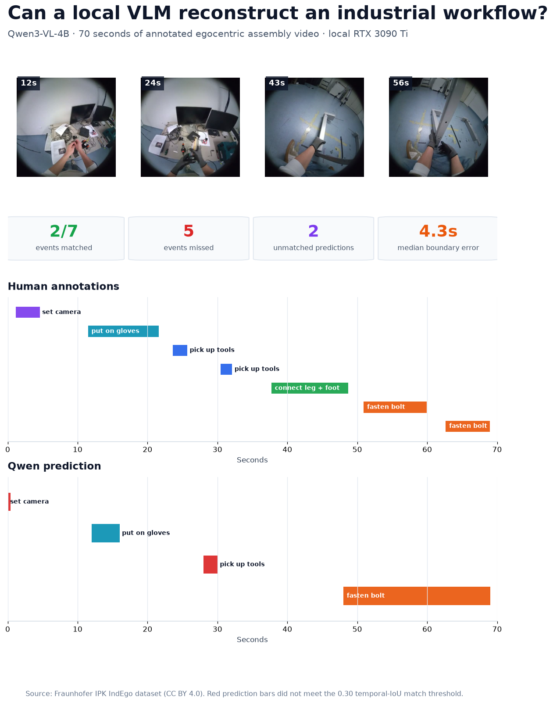
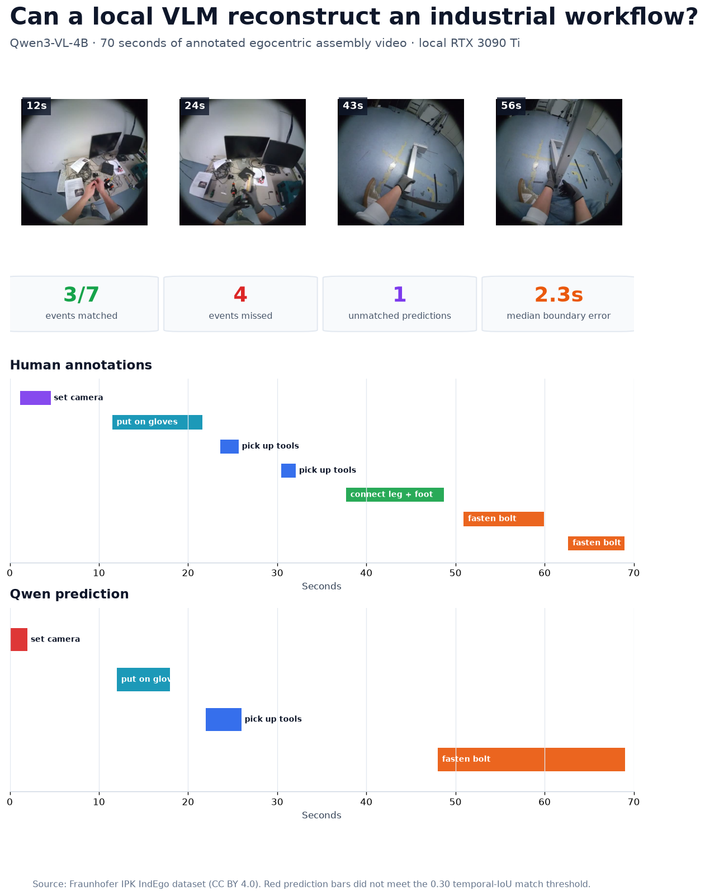

# Can a local VLM reconstruct an industrial workflow?

This project tests whether local Qwen3-VL models can convert annotated industrial assembly footage into an auditable event timeline, and whether moving from 4B to 8B parameters materially improves temporal grounding on an RTX 3090 Ti.





## Result

On one 70-second egocentric assembly clip, the 8B model improved every scored metric over the 4B baseline at a temporal intersection-over-union threshold of 0.30, but still recovered fewer than half of the seven annotated events.

| Configuration | Matched | Precision | Recall | F1 | Mean tIoU | Median boundary error | Inference | Peak VRAM |
| --- | ---: | ---: | ---: | ---: | ---: | ---: | ---: | ---: |
| Qwen3-VL-4B BF16 | 2 / 7 | 0.50 | 0.29 | 0.36 | 0.41 | 4.26 s | 25.2 s | 18.5 GB |
| Qwen3-VL-8B INT8 | 3 / 7 | 0.75 | 0.43 | 0.55 | 0.51 | 2.27 s | 55.1 s | 19.7 GB |

The 8B model localized glove use and the first tool pickup more accurately and produced a valid camera interval. It still merged two separate fastening events into one long interval, missed the leg-and-foot connection, and missed the second tool pickup. The 4B model had the same broad failure pattern and also emitted an invalid zero-length camera interval.

This is a one-clip case study, not a general benchmark. The useful result is the gap between a plausible description of the workflow and a timeline that can be checked event by event.

## Interactive audit demo

[`demo/`](demo/) contains a buildless browser interface that synchronizes the source video with the human annotations and both Qwen runs. It includes a custom scrubber, clickable event blocks, a live playhead, per-event evidence, overlap status, and a 4B/8B selector.

Serve the repository root, then open `http://localhost:8000/demo/`:

```powershell
.\.venv\Scripts\python.exe -m http.server 8000
```

The source clip is intentionally excluded from Git. The demo loads the locally prepared clip when present and otherwise offers a browser-local file picker. See [`demo/README.md`](demo/README.md) for the data contract and portfolio-site integration notes.

## Experiment design

The source is a 70-second excerpt from Fraunhofer IPK's [IndEgo dataset](https://huggingface.co/datasets/FraunhoferIPK/IndEgo). The matching human timestamp annotations contain seven complete events:

1. Set camera
2. Put on gloves
3. Pick up tools
4. Pick up tools
5. Connect leg and foot
6. Fasten bolt
7. Fasten bolt

Qwen receives:

- 70 frames sampled uniformly at 1 FPS;
- the valid action vocabulary, but not the timestamps or event count;
- a JSON schema requiring an action, start time, end time, evidence, and confidence;
- instructions to report only visibly supported actions.

Supplying the vocabulary makes this a temporal recognition and localization task. It is not open-ended action discovery.

Predictions are matched one-to-one by action label using an exact maximum-cardinality assignment. A match requires at least 0.30 temporal IoU. Unmatched predictions are separated into unsupported labels, duplicate predictions, and correct-label-but-mislocalized predictions rather than labeling every timing failure a hallucination.

## Local deployment observations

Both completed configurations used 131,072 maximum pixels per sampled frame and a 6,144,000-pixel total video budget. The 4B model ran in BF16. The 8B model used INT8 weights with FP16 compute so it could remain operational on a 24 GB GPU.

Several full-precision or denser configurations were deliberately stopped after bounded trials:

- Qwen3-VL-8B in BF16 at 1 FPS consumed approximately 23.8–23.9 GB of VRAM and did not complete within 8–10 minutes because automatic CPU offload made generation impractically slow.
- Qwen3-VL-4B at 2 FPS consumed approximately 23.9 GB and did not complete within 8 minutes.

The completed 8B INT8 run took 55.1 seconds and peaked at 19.7 GB of allocated VRAM. This is not a precision-controlled model-size benchmark: quantization is a confounding variable. It is a practical deployment comparison showing how a larger model can become usable on consumer hardware. See [`results/runtime_observations.json`](results/runtime_observations.json) for the recorded settings.

## Reproduce

### Requirements

- Windows with an NVIDIA GPU and current driver
- Approximately 25 GB of free disk space
- [uv](https://docs.astral.sh/uv/)
- [FFmpeg](https://ffmpeg.org/)

The `uv` configuration selects CUDA 12.8 PyTorch wheels on Windows. Other platforms may need to adjust the PyTorch package source in `pyproject.toml`.

### Run

```powershell
uv sync
uv run python src/download_data.py
uv run python src/prepare_clip.py
uv run python src/run_inference.py --prompt timeline --fps 1
uv run python src/run_inference.py `
  --model Qwen/Qwen3-VL-8B-Instruct `
  --prompt timeline --fps 1 --quantization int8
uv run python src/evaluate.py `
  --prediction timeline_qwen3-vl-4b-instruct_1fps_prediction.json `
  --name qwen3_vl_4b_1fps
uv run python src/visualize.py `
  --prediction timeline_qwen3-vl-4b-instruct_1fps_prediction.json `
  --evaluation qwen3_vl_4b_1fps_evaluation.json
uv run python -m unittest discover -s tests -v
```

Model weights, source video, extracted frames, and the processed clip are excluded from Git. The downloader retrieves the required assets from the publisher and writes tracked source URLs, sizes, and SHA-256 hashes to [`data/manifest.json`](data/manifest.json).

## Files worth inspecting

- [`prompts/timeline.txt`](prompts/timeline.txt): exact structured prompt
- [`data/processed/ground_truth.json`](data/processed/ground_truth.json): clipped reference events
- [`results/timeline_qwen3-vl-4b-instruct_1fps_raw.txt`](results/timeline_qwen3-vl-4b-instruct_1fps_raw.txt): unedited model response
- [`results/qwen3_vl_4b_1fps_evaluation.json`](results/qwen3_vl_4b_1fps_evaluation.json): event-level scoring details
- [`results/timeline_qwen3-vl-4b-instruct_1fps_run.json`](results/timeline_qwen3-vl-4b-instruct_1fps_run.json): runtime and environment metadata
- [`results/timeline_qwen3-vl-8b-instruct_1fps_int8_raw.txt`](results/timeline_qwen3-vl-8b-instruct_1fps_int8_raw.txt): unedited 8B response
- [`results/qwen3_vl_8b_1fps_int8_evaluation.json`](results/qwen3_vl_8b_1fps_int8_evaluation.json): 8B event-level scoring details
- [`results/timeline_qwen3-vl-8b-instruct_1fps_int8_run.json`](results/timeline_qwen3-vl-8b-instruct_1fps_int8_run.json): 8B runtime and environment metadata

## Limitations

- One clip cannot establish model-wide performance.
- Human timestamps are reference annotations, not perfect ground truth.
- The model sees sampled frames, not continuous video.
- Self-reported confidence values are not calibrated probabilities.
- This is offline analysis; the model can use future frames when describing earlier events.
- The 4B-versus-8B comparison also changes weight precision, from BF16 to INT8.
- The experiment does not test persistent worker tracking, audio, live alerts, or safety-rule enforcement.

A general-purpose VLM may be useful for indexing video, proposing events, and retrieving evidence. This experiment does not support using one as the sole decision-maker for safety or quality control.

## Data and code licenses

IndEgo is published by Fraunhofer IPK under [CC BY 4.0](https://creativecommons.org/licenses/by/4.0/). This project downloads one source video, its matching annotations, and the procedure keysteps from the [official Hugging Face repository](https://huggingface.co/datasets/FraunhoferIPK/IndEgo). The source video is not redistributed here.

Project code is released under the [MIT License](LICENSE).
